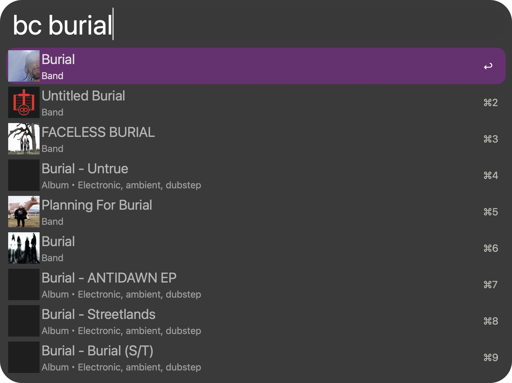

<p align="center">
  
</p>

<h1 align="center">Bandcamp for Alfred</h1>

<p align="center">Search Bandcamp artists, labels, albums and tracks from Alfred.</p>

<p align="center">
  <a href="https://github.com/aleksgorbenko/alfred-workflow-bandcamp/actions/workflows/ci.yml"></a>
  <a href="https://github.com/aleksgorbenko/alfred-workflow-bandcamp/releases/latest"></a>
  <a href="LICENSE"></a>
  
  <a href="https://www.alfredapp.com/powerpack/"></a>
</p>

<p align="center">
  <a href="#commands">Commands</a> ·
  <a href="#install">Install</a> ·
  <a href="#development">Development</a>
</p>

Type `bc` and a query to search Bandcamp as you type.



Alfred Workflow to browse [Bandcamp](https://bandcamp.com). Bandcamp has no public API - this talks to the JSON endpoint Bandcamp's own search box calls, and parses the JSON blobs Bandcamp embeds in its server-rendered band/label/release pages.

## Commands

### `bc <query>` - search Bandcamp

Searches bands, labels, albums, and tracks as you type; no Enter needed.

- Enter on a band/label drills into its releases; Enter on an album/track shows its tracklist.
- Cmd+Enter at any point opens that item's Bandcamp page directly.

### Maintenance

- `:bc` - cache size (Enter reveals the folder) and Empty Cache.

## Install

1. Download the latest `Bandcamp.alfredworkflow` from [Releases](https://github.com/aleksgorbenko/alfred-workflow-bandcamp/releases).
2. Double-click it - Alfred will prompt to import.
3. Requires [Alfred](https://www.alfredapp.com) with a Powerpack licence.

## Development

- Python 3.14, stdlib only.
- `src/bcapi/` - runtime scripts Alfred calls.
- `tools/` - dev-only scripts (bundle verification), not shipped.

```sh
make setup   # install dev tools and the Python environment
make ci      # everything CI runs
make check    # lint + format check + tests
make build    # package dist/Bandcamp.alfredworkflow
make verify   # audit the built bundle for local paths, junk files, unresolved script refs
make release VERSION=v1.0.0
make sync-plist WORKFLOW_DIR=/path/to/installed/workflow   # pull info.plist edits back
make link-live WORKFLOW_DIR=/path/to/installed/workflow    # symlink src/ for live dev
```

## My Other Workflows

- [Netlify for Alfred](https://github.com/aleksgorbenko/alfred-workflow-netlify)
- [Discogs for Alfred](https://github.com/aleksgorbenko/alfred-workflow-discogs)
- [WaniKani for Alfred](https://github.com/aleksgorbenko/alfred-workflow-wanikani)
- [2Do for Alfred](https://github.com/aleksgorbenko/alfred-workflow-2do)
- [BunPro for Alfred](https://github.com/aleksgorbenko/alfred-workflow-bunpro)
- [config](https://github.com/aleksgorbenko/config) - index of all my workflows, plus macOS/iOS setup
